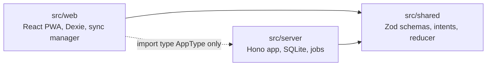

# HomeHub — Coding Standards

Nov 23, 2026 · Ethan

## How to use these standards

Every HomeHub change follows these rules, whether Claude Code or I wrote it, and every review checks against them.

- Rules are **MUST** unless marked **(SHOULD)**. Breaking a MUST rule is a Blocker in review; break a SHOULD rule only with a reason in the PR.
- Each rule has an ID, such as SYNC-4, so plans, commits and review comments can cite it.
- Tools enforce what they can (see Tooling). If a tool's config and this doc disagree, the config wins and this doc gets updated.
- Changing a rule takes a PR to this doc; a change that affects the architecture also gets an ADR.
- Claude Code loads this file at the start of every session through CLAUDE.md (AI-1), so each rule is short, concrete and checkable.

## General principles

These apply to every file in the repo.

- **GEN-1** Write for the reader: clear names beat comments, and code is read far more often than it is written.
- **GEN-2** Each function does one job; prefer early returns over deep nesting.
- **GEN-3 (SHOULD)** Keep functions under about 30 lines and nesting to 3 levels.
- **GEN-4** No magic numbers or strings: name them as constants or move them to configuration.
- **GEN-5** Build only what the current build-plan phase needs; no speculative abstractions or extension points.
- **GEN-6** No dead code, commented-out code or unused dependencies; Git history keeps the old version.
- **GEN-7** Follow the existing pattern in the codebase over personal (or model) preference, unless an ADR changes it.
- **GEN-8 (SHOULD)** Prefer a little duplication over the wrong abstraction; extract shared code on the third use.
- **GEN-9** Prefer the platform: use Node, web-standard APIs and existing dependencies before adding a package. A new runtime dependency needs a line in the PR saying why, an MIT, Apache-2.0 or similar permissive license, and a release in the last year.

## Git workflow and pull requests

All work reaches main through short-lived branches and pull requests that I read before merging.

- **GIT-1** main is protected and always deployable: no direct pushes, and merging needs a pull request with passing CI. Every merge to main deploys itself.
- **GIT-2** Branches are short-lived and named type/short-description, for example feat/grocery-outbox or fix/halloween-timezone.
- **GIT-3** Commit messages and PR titles follow Conventional Commits, for example `feat(grocery): flush outbox when the app becomes visible`. Types: feat, fix, refactor, perf, test, docs, chore, ci, build.
- **GIT-4 (SHOULD)** Keep each PR to one concern and under about 400 changed lines, not counting the lockfile.
- **GIT-5** Squash-merge PRs so main has one commit per change, using the PR title as the message.
- **GIT-6** Every PR description says what changed, why and how it was tested, and links its issue, build-plan step or ADR (template under Code reviews). PRs that Claude Code opens use the same template.
- **GIT-7** Never commit secrets, .env files, the data/ folder, build output or node_modules; .gitignore and .gitattributes (LF line endings) live at the repo root.

## TypeScript

One strict TypeScript codebase runs in three places: Node 26 on the server, the browser, and shared code used by both.

- **TS-1** The compiler runs with strict, noUncheckedIndexedAccess, noImplicitOverride and noFallthroughCasesInSwitch. No `any` (use `unknown` and narrow it). Never `@ts-ignore`; `@ts-expect-error` needs a comment explaining why.
- **TS-2** Erasable syntax only (erasableSyntaxOnly), because Node runs the server by stripping types: no `enum`, `namespace`, constructor parameter properties or `import =`. Use union types and `as const` objects instead.
- **TS-3** ES modules only. Relative imports include the `.ts` or `.tsx` extension, such as `./sync-manager.ts`, and type-only imports use `import type` (verbatimModuleSyntax).
- **TS-4** Naming: camelCase for variables and functions, PascalCase for types and React components, UPPER_SNAKE_CASE for module-level constants, and is/has/can prefixes for booleans. File names are kebab-case (`sync-manager.ts`), except component files, which match the component (`GroceryTile.tsx`).
- **TS-5** Validate data at every trust boundary with a Zod schema: request bodies and query strings, environment variables, JSON stored in SQLite, and photo metadata. Types come from the schemas (`z.infer`), never written twice; inside the boundary, trust the types.
- **TS-6** No floating promises: every promise is awaited, returned, or explicitly voided with a comment. Never pass an async function where a synchronous callback is expected.
- **TS-7** Expected outcomes, such as not found, invalid input or a rejected mutation, are returned as discriminated unions (`{ ok: true, value }` or `{ ok: false, error }`), not thrown. Throw only for the unexpected, and only Error objects.
- **TS-8** Logic never reads the clock directly (`Date.now()`, `new Date()`, `Temporal.Now`). Server code takes a `clock` from main.ts; web code calls one `now()` helper that tests can fake. Instants are UTC; local dates use HOME_TZ.
- **TS-9** IDs are UUIDv7 from the uuid package's `v7()`, on clients and the server; `crypto.randomUUID()` only makes v4.
- **TS-10** Use named exports only. Default exports are allowed only where a tool requires one, such as vite.config.ts or playwright.config.ts.
- **TS-11** Modules get their dependencies (database, clock, logger, config, API client) as parameters from a composition root, never by importing a mutable singleton, so tests can pass fakes.
- **TS-12 (SHOULD)** Prefer functions and plain objects over classes, `const` over `let`, and `readonly` for shared data; never mutate a function's arguments.

## Architecture and module boundaries

One repository and one package with three source folders. Arrows are allowed imports.



- **ARCH-1** src/shared is pure TypeScript: no imports from src/server or src/web, no Node built-ins (`node:*`), no DOM APIs and no I/O. It holds the Zod schemas, the sync intents, the intent reducer and shared constants.
- **ARCH-2** src/web never imports runtime code from src/server. Its only server import is `import type { AppType }` for the typed client.
- **ARCH-3** src/server never imports from src/web.
- **ARCH-4 (SHOULD)** Both sides are organized by feature (grocery, shopping, photos, themes, status), and one feature uses another only through that feature's index.ts.
- **ARCH-5** Inside a server feature, routes.ts handles HTTP (validate, call the service, map the result), service.ts holds the rules and transactions, and repo.ts holds the SQL. Routes contain no SQL or business rules; repos contain no business rules.
- **ARCH-6** src/server/main.ts is the only composition root: it reads the config, opens the database, builds the app, starts the jobs and handles shutdown. Nothing else reads `process.env`.
- **ARCH-7** ESLint import restrictions fail CI when a boundary above is broken.

## Server and API

The server is one Hono app on Node 26. Its routes are typed end to end and thin.

- **SRV-1** API routes live under /api/{feature} with lowercase noun paths, such as /api/grocery/sync/push. Routes are defined by method chaining so their types reach the client, and src/server/app.ts exports `AppType`.
- **SRV-2** Every route validates its params, query and body with a Zod schema through Hono's validator middleware, and handlers read input only from `c.req.valid(...)`.
- **SRV-3** The web app calls the API only through the typed Hono client (`hc<AppType>`), never with hand-written fetch calls or response types. The two exceptions are the EventSource for /api/events and image URLs under /media.
- **SRV-4** Errors are JSON in one shape, RFC 9457 Problem Details (`type`, `title`, `status`, `detail`), produced by one `app.onError` handler and the route results. Responses never include stack traces or SQL.
- **SRV-5** JSON is camelCase. Instants are ISO 8601 strings in UTC, calendar dates are `YYYY-MM-DD`, and IDs are UUID strings.
- **SRV-6** Every /api route requires an allowed Tailscale identity (SEC-3). The one exception is GET /api/health, which the container health check calls and which reveals only status details, never personal data.
- **SRV-7** Request handlers stay fast because better-sqlite3 blocks the event loop while a query runs: queries are indexed and bounded with LIMIT, and slow work such as image processing runs in a background job, never in a request.
- **SRV-8** On SIGTERM or SIGINT the server stops accepting requests, closes SSE streams, stops the jobs, ends exiftool and closes the database, all within Docker's 10-second stop timeout.
- **SRV-9** Configuration comes from environment variables, parsed once at startup by a Zod schema in config.ts. Invalid config stops the process with a clear message.
- **SRV-10** Background jobs (photo scan, backups) start from one scheduler in main.ts, never overlap with themselves, and log when they start, finish or fail.

## Data and SQLite

One SQLite file, opened by one server process, is the source of truth.

- **DATA-1** Tables and columns are snake_case and table names are plural. The one exception is sync_state, which holds a single row, so a plural name would mislead.
- **DATA-2** Every table is STRICT. Primary keys are UUIDv7 stored as TEXT, except sync_state (its single row has the key 1) and theme_rules (keyed by a readable key such as halloween).
- **DATA-3** Instants are INTEGER Unix epoch milliseconds in UTC, in columns ending in _at. Booleans are INTEGER 0 or 1 with a CHECK constraint. JSON is TEXT with a `json_valid()` CHECK.
- **DATA-4** The schema changes only through numbered SQL files in src/server/db/migrations (0001_init.sql, 0002_…). At startup the server backs up the database, then applies pending files in order, each in a transaction, and records progress in `PRAGMA user_version`. Never edit a migration that has run anywhere, including on your desktop; add a new one.
- **DATA-5** Every connection sets `journal_mode = WAL`, `synchronous = NORMAL`, `foreign_keys = ON` and `busy_timeout = 5000`. Only the server process opens the database.
- **DATA-6** SQL uses prepared statements with bound parameters; never build SQL by concatenating values. PRAGMA values, which can't be bound, come only from constants in code.
- **DATA-7** A write that touches more than one row or table runs inside one `db.transaction()`. Transaction functions are synchronous: never pass an async function or await inside one. better-sqlite3 throws when the function returns a promise, and any code after the first await would run outside the transaction.
- **DATA-8 (SHOULD)** Index the columns used for filters, joins and sync cursors, such as sync_version, and check new queries with EXPLAIN QUERY PLAN.
- **DATA-9** The database file, its -wal and -shm files and its backups live on a local disk inside the data volume, never on a network share or in a cloud-synced folder such as OneDrive; both corrupt SQLite.
- **DATA-10** Backups use SQLite's online backup (`db.backup()`) or `VACUUM INTO`, never a file copy of a live database, and a restore is tested after any change to the backup code.
- **DATA-11 (SHOULD)** Migrations are additive: add tables and columns in one release and remove old ones in a later release, so the previous image still runs if you roll back.

## Web app (React)

The web app is one React 19 codebase with a wall layout and a phone layout.

- **WEB-1** Use function components and hooks only. Components are PascalCase, and hooks start with use.
- **WEB-2** Follow the Rules of Hooks (lint-enforced). Derive values during render instead of syncing state with useEffect; effects are only for external systems such as timers, EventSource and the document.
- **WEB-3** Organize code by feature (features/grocery, features/photos, features/themes), with shared UI in components/ and data access in data/.
- **WEB-4** Components read app data only from Dexie, through useLiveQuery hooks in data/, and change it only through the sync layer's actions. They never call fetch or the API client.
- **WEB-5** Style with Tailwind utilities and theme tokens (CSS custom properties). No hard-coded colors, so every seasonal theme applies everywhere.
- **WEB-6** Every theme meets WCAG AA contrast: at least 4.5:1 for body text and 3:1 for large text and UI parts.
- **WEB-7** Touch targets are at least 48 by 48 pixels on phones and 64 by 64 on the wall; nothing depends on hover.
- **WEB-8** On the wall, animate only transform and opacity with Motion, never use backdrop-filter, honor prefers-reduced-motion, and check changes on the real display.
- **WEB-9** Every view handles loading, empty, offline and error states, and each feature area sits inside an error boundary.
- **WEB-10** The wall layout fills 1920 by 1080 with no scrolling; the phone layout works from 360 pixels wide.
- **WEB-11** Use semantic HTML: buttons for actions, labels for inputs and a visible focus style. Automated axe scans stay clean.
- **WEB-12** The service worker precaches the app shell, caches /media images with an entry limit, and never caches /api responses, because Dexie is the offline store. The navigation fallback excludes /api and /media.

## Offline sync rules

Sync is the riskiest code in HomeHub, so any change that touches it follows these rules and gets the closest review (AI-6).

- **SYNC-1** Every local change and its outbox entry are written in one Dexie transaction, and nothing inside a Dexie transaction awaits the network.
- **SYNC-2** Mutations express intent (AddItem, MarkPurchased, NeedAgain, SetQuantity, EditNotes, DeleteItem), never whole-row overwrites.
- **SYNC-3** The intent reducer in src/shared is the only definition of what each intent does; the client and the server both call it.
- **SYNC-4** Every mutation carries a client-generated UUIDv7 mutationId, and the server applies each mutationId at most once.
- **SYNC-5** The sync_state version bump and the data writes share one SQLite transaction, and every row the transaction changes is stamped with the new version.
- **SYNC-6** Synced rows are soft-deleted (is_deleted = 1) so pulls return tombstones; they are never hard-deleted.
- **SYNC-7** Server-Sent Events carry no row data, only a signal to pull (and at most the latest version number).
- **SYNC-8** After a pull, unsent intents are re-applied on top of the server's rows (rebase).
- **SYNC-9** A rejected mutation leaves the outbox and is shown in the UI; it is never retried forever. Network errors and 5xx responses retry with backoff; a 4xx response or a rejected result does not.
- **SYNC-10** Mutation shapes stay backward compatible: add optional fields, but never rename or remove one, because a phone may hold unsent entries from an older app version.
- **SYNC-11** Every sync change ships with tests: Vitest for the reducer and the client (fake-indexeddb), server tests against a real SQLite database, and the Playwright offline scenarios still pass.

## Security

HomeHub is never on the public internet: the tailnet is the perimeter. These rules keep it closed and limit what a lost phone or a bad dependency can do.

- **SEC-1** No secrets in the repo or the image. The host's .env file stays on the host, CI uses only GitHub's built-in token, and secret scanning with push protection stays on. The .env and data/ in the repo folder hold only development values; real secrets and data stay on the host, outside the repo (C:\HomeHub for now).
- **SEC-2** The server is reachable only from its own machine: Compose publishes `127.0.0.1:8080`, and Tailscale Serve on the same machine is its only client. Never publish the port on all interfaces, never turn on Tailscale Funnel, and never forward a router port.
- **SEC-3** Every /api request (except health) must carry a Tailscale-User-Login header on the ALLOWED_USERS list, or it gets 401. The header is trusted only because of SEC-2. The DEV_USER override for local development works only when NODE_ENV is development, and config validation refuses it otherwise.
- **SEC-4** Requests that change state use POST, PUT, PATCH or DELETE, never GET. They must be same-origin (Hono's csrf middleware) and carry JSON, except photo uploads. The server never sends CORS headers.
- **SEC-5** Treat all input as untrusted, including file names, EXIF and IPTC data and uploaded images: validate it, cap sizes (bodyLimit on uploads, a pixel limit in sharp), generate file names on the server, and never use a client-supplied path.
- **SEC-6** Images are served only as sharp re-encodes with metadata stripped, so no GPS location leaves the server; the API exposes only the placard fields.
- **SEC-7** Logs never contain email addresses, secrets or request bodies; users appear by their short name.
- **SEC-8** Every response gets security headers through Hono's secureHeaders, with a Content Security Policy that allows only the app's own origin.
- **SEC-9** The container runs as the non-root node user with all capabilities dropped and no-new-privileges. **(SHOULD)** Run it with a read-only root filesystem, writable only at /data and /tmp.
- **SEC-10** Dependabot watches npm, GitHub Actions and the Docker base image. A high or critical npm audit finding blocks merging until it's fixed, the lockfile is committed, and every install uses `npm ci`.
- **SEC-11** The tailnet holds only our own devices. Key expiry is turned off only for the server and the wall, and a lost phone is removed in the Tailscale admin console the same day.

## Testing

Tests prove behavior, run on every push, and never depend on the real clock or on each other.

- **TEST-1** Every bug fix includes a test that fails without the fix.
- **TEST-2** New logic in src/shared, services and the sync layer ships with tests in the same PR.
- **TEST-3 (SHOULD)** Aim for about 80% line coverage on src/shared and the server services; treat the number as a signal, not a target.
- **TEST-4** Test names are sentences that describe behavior, such as "re-applies unsent intents after a pull".
- **TEST-5** Each test follows Arrange, Act, Assert and checks one behavior.
- **TEST-6** Server tests use a real SQLite database (in memory or a temp file) built by the real migrations, never a mock of the database. Route tests call `app.request()`.
- **TEST-7** Time is faked: server code gets a fixed clock, Vitest uses fake timers, and Playwright uses `page.clock`. Tests never sleep or depend on today's date.
- **TEST-8** Tests are independent and can run in any order and in parallel; each gets its own database and its own Dexie instance.
- **TEST-9** A flaky test is fixed, or quarantined with a linked issue, the same day; it never stays flaky on main.
- **TEST-10** A test is never weakened to make it pass. Changing an assertion, skipping a test or deleting one needs a reason in the PR description.

## Errors, logging and observability

Failures are logged once, with structure, and every request can be traced through the logs.

- **OBS-1** Log structured JSON with pino, data in fields and a fixed message, such as `log.info({ itemId }, 'item purchased')`; never build messages with string interpolation.
- **OBS-2** Log levels: error needs attention, warn is a handled problem, info marks key events, and debug is detail for troubleshooting. Production logs at info.
- **OBS-3** Never swallow an error. Catch only what you can handle, and log an error once, where it's handled.
- **OBS-4** Unhandled errors go through `app.onError`, which logs them and returns Problem Details. An unhandled rejection or exception at process level is logged and exits, and Docker restarts the container.
- **OBS-5** Every request gets a request ID that appears in its log lines and in any error response.
- **OBS-6** GET /api/health reports the version (Git commit), database status and the times of the last photo scan and backup, and the wall's status tile shows them.
- **OBS-7 (SHOULD)** Log counts and durations for each sync push and pull and each processed photo, so a shopping trip can be reconstructed from the logs.

## Documentation

Write down the why; the code already shows the what.

- **DOC-1** Each significant decision gets a numbered ADR in docs/adr with context, decision, alternatives considered and consequences. An accepted ADR is never rewritten; a new ADR supersedes it.
- **DOC-2** Comments explain why, not what.
- **DOC-3** Exported functions in src/shared and in server services have a one-line TSDoc summary.
- **DOC-4** The root README explains what HomeHub is and how to run, test and deploy it; update it in the same PR as any setup change.
- **DOC-5** Every TODO links an issue, such as TODO(#42); no anonymous TODOs.
- **DOC-6** When a change alters the design, the commands or the layout, the same PR updates docs/project-overview.md and CLAUDE.md, so Claude Code's context stays true.

## Working with Claude Code

Claude Code writes most of HomeHub's code. I stay the architect and the reviewer, and these rules keep that arrangement safe.

- **AI-1** CLAUDE.md at the repo root imports this file (`@docs/coding-standards.md`) and lists the commands, layout and workflow. Keep it under about 150 lines, and update it in the same PR as any change it describes (DOC-6).
- **AI-2** Use plan mode, and approve a written plan before any edits, for changes to sync, migrations, security, CI/CD or deploy scripts, or anything that deletes data. **(SHOULD)** Do the same for any change that spans more than a few files.
- **AI-3** One task per session: start fresh (/clear) for each issue or build-plan step, and give Claude the step, the relevant docs sections and the check that proves it's done.
- **AI-4** Claude runs `npm run check`, plus `npm run e2e` when UI, PWA or sync code changed, and shows them passing before calling a task done.
- **AI-5** I read every line of the diff before merging. Code I can't explain doesn't merge: ask Claude to explain it or make it simpler.
- **AI-6** Changes to sync, security, migrations or CI/CD get a second, independent review in a fresh session that didn't write the code, using the /standards-review skill or this claude.ai project.
- **AI-7** The committed .claude/settings.json allows npm scripts and read-only Git except `git diff`, because a path outside the repo switches it to `--no-index` without the flag; asks before `git push`, Docker commands, installs, edits to package.json or the lockfile (enforcing AI-8), and Git commands that use `--output` or `--no-index` or name a .env file; and denies reading .env files and the data/ folder. Every shell rule is written for both Bash and PowerShell, `blockReadsOutsideWorkingDirectories` stops Claude's file tools from reading outside the repo, and `disableBypassPermissionsMode` and `disableAutoMode` keep bypassPermissions and auto mode off.
- **AI-8** New dependencies are proposed in the plan with a reason (GEN-9); Claude never changes package.json or the lockfile without saying so.
- **AI-9** Never paste secrets or other people's personal data into a prompt; Claude Code keeps transcripts as plain text on the desktop.
- **AI-10** Before using a library API that isn't already used in the repo, Claude checks the installed package's types or its official docs. An invented or guessed API is a Blocker.

## Tooling and enforcement

Tools enforce formatting and most rules, so reviews can focus on design and correctness.

npm scripts are the single entry point for people, Claude Code and CI:

| Script | Does |
| --- | --- |
| `npm run dev` | Server in watch mode (`node --watch`) plus the Vite dev server, which proxies /api, /media and /api/events |
| `npm run check` | Typecheck both configs, ESLint, Prettier check, Vitest; the gate for every task (AI-4) |
| `npm run e2e` | Playwright against a production build with a temporary data folder |
| `npm run build` | Production web build into dist/web |
| `npm start` | `node src/server/main.ts`, which is what the container runs |

- Node 26 is pinned in package.json `engines`, an .nvmrc file read by CI, and the `node:26-slim` base image.
- TypeScript stays on 6.0 for now. TypeScript 7.0 (July 2026) ships no API yet, so typescript-eslint can't run on it; Dependabot ignores TypeScript 7 until typescript-eslint supports TypeScript 7.1's new API.
- Two TypeScript configs share tsconfig.base.json: the root tsconfig.json (server, shared, tests and tool configs, Node types, `module: nodenext`, lib es2025 plus esnext.temporal) and src/web/tsconfig.json (web and shared, DOM types, `module: preserve`, `jsx: react-jsx`). `npm run typecheck` runs `tsc --noEmit` on both.

tsconfig.base.json:

```json
{
  "compilerOptions": {
    "target": "es2025",
    "strict": true,
    "noUncheckedIndexedAccess": true,
    "noImplicitOverride": true,
    "noFallthroughCasesInSwitch": true,
    "erasableSyntaxOnly": true,
    "verbatimModuleSyntax": true,
    "allowImportingTsExtensions": true,
    "noEmit": true,
    "skipLibCheck": true
  }
}
```

- TypeScript 6 defaults `types` to an empty list, so each config names its own: `["node"]` at the root, and `["vite/client", "node"]` in src/web, where Node types are needed only because the client imports the server's `AppType`.
- ESLint (flat config) uses typescript-eslint's strict-type-checked and stylistic-type-checked presets, eslint-plugin-react-hooks, eslint-plugin-jsx-a11y and `@typescript-eslint/no-restricted-imports` for the ARCH boundaries (with `allowTypeImports` for AppType). Prettier owns formatting through eslint-config-prettier.
- Vitest runs two projects: node (src/shared, src/server) and web (src/web, jsdom, fake-indexeddb, Testing Library).
- Playwright runs three projects: wall (Chromium at 1920 by 1080), iPhone (WebKit) and Android (Chromium, Pixel viewport), with @axe-core/playwright for accessibility.

CI gates on every pull request; all must pass to merge:

1. `npm ci`, then `npm run check` (typecheck, lint, format, unit tests with coverage).
2. `npm run e2e` with the Playwright report uploaded as an artifact.
3. `npm audit --audit-level=high`.
4. The Docker image builds (pushing to GHCR happens only on main).
5. CodeQL default setup and secret scanning run alongside, from the repository's security settings.

## Code reviews

Every PR is reviewed against this doc before it merges, and each finding names its severity and the rule it cites.

| Severity | Meaning | Before merge |
| --- | --- | --- |
| Blocker | A bug, security hole, data-loss risk, invented API or broken MUST rule | Must be fixed |
| Should fix | A broken SHOULD rule or a clear maintainability problem | Fix now, or open an issue and link it |
| Nit | Small polish the tools don't catch | Optional |
| Praise | Something done well that's worth repeating | Nothing to do |

Review checklist, in priority order:

1. Correctness: it does what the PR says, including edge cases such as offline use, time zones and empty states.
2. Security: the SEC rules hold, including identity, same-origin writes, input limits, and no secrets or personal data in code or logs.
3. Sync safety: the SYNC rules hold for any change to the outbox, the reducer, the sync endpoints or versioning.
4. Tests: new behavior and bug fixes are covered, the tests would fail if the code broke, and no test was weakened (TEST-10).
5. Architecture: imports follow the ARCH rules, and logic lives in the right layer.
6. AI hygiene: no invented APIs (AI-10), no unexplained dependencies (AI-8), and CLAUDE.md and the docs still match the code (DOC-6).
7. Readability: names, size and structure, with comments that explain why.
8. Performance: bounded queries, no work on the request path that belongs in a job, and smooth wall animations.

**Asking for a review:** in a fresh Claude Code session, run `/standards-review`, a project skill in .claude/skills that reviews `git diff main...HEAD` against this doc. Or paste the PR description and the diff into the HomeHub claude.ai project. Either way, the review comes back grouped by severity, with each finding citing a rule ID. The bundled `/security-review` is a useful second pass for SEC changes.

PR template (.github/pull_request_template.md):

```markdown
## What changed

## Why

## How it was tested

## Links (issue, build-plan step or ADR)

- [ ] `npm run check` passes, and `npm run e2e` passes if UI, PWA or sync changed
- [ ] Tests added or updated; none weakened or skipped (TEST-10)
- [ ] I read every line of this diff and can explain it (AI-5)
- [ ] Docs, CLAUDE.md or an ADR updated if setup, design or a decision changed
- [ ] Checked on a phone or the wall (UI changes only)
```

**Definition of Done:** the PR is merged with every Blocker resolved and CI green, the host is running the new image (the health endpoint shows the new commit), and user-facing changes are checked on a real phone or the wall.
