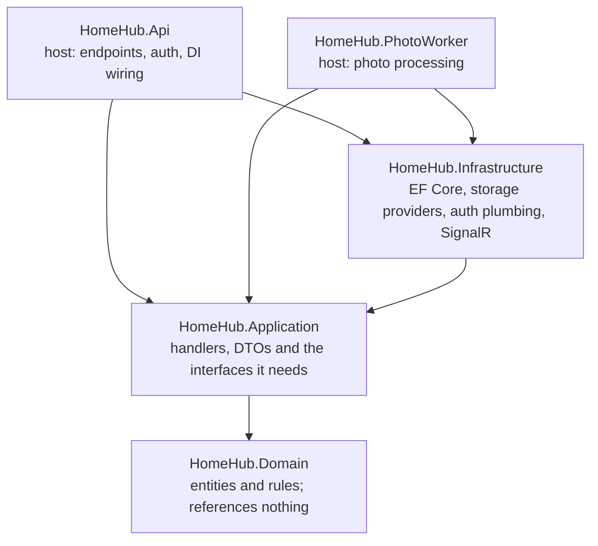

# HomeHub — Coding Standards

Oct 15, 2026 · Ethan

## How to use these standards

Every HomeHub pull request follows these rules, and every code review checks against them.

- Rules are **MUST** unless marked **(SHOULD)**. Breaking a MUST rule is a Blocker in review; break a SHOULD rule only with a reason in the PR.
- Each rule has an ID, such as NET-6, so review comments can cite it.
- Formatters and analyzers enforce what they can (see Tooling). If a tool's config and this doc disagree, the config wins and this doc gets updated.
- Changing a rule takes a PR to this doc; a change that affects the architecture also gets an ADR.

## General principles

These apply to every language in the repo.

- **GEN-1** Write for the reader: clear names beat comments, and code is read far more often than it is written.
- **GEN-2** Each function does one job; prefer early returns over deep nesting.
- **GEN-3 (SHOULD)** Keep functions under about 30 lines and nesting to 3 levels.
- **GEN-4** No magic numbers or strings: name them as constants or move them to configuration.
- **GEN-5** Build only what the current roadmap phase needs; no speculative abstractions or extension points.
- **GEN-6** No dead code, commented-out code or unused dependencies; Git history keeps the old version.
- **GEN-7** Follow the existing pattern in the codebase over personal preference, unless an ADR changes it.
- **GEN-8 (SHOULD)** Prefer a little duplication over the wrong abstraction; extract shared code on the third use.

## Git workflow and pull requests

All work reaches main through short-lived branches and reviewed pull requests.

- **GIT-1** main is protected and always deployable: no direct pushes, and merging needs passing CI and a review.
- **GIT-2** Branches are short-lived and named type/short-description, for example feat/grocery-outbox or fix/halloween-timezone.
- **GIT-3** Commit messages and PR titles follow Conventional Commits, for example `feat(grocery): flush outbox when the app becomes visible`. Types: feat, fix, refactor, perf, test, docs, chore, ci.
- **GIT-4 (SHOULD)** Keep each PR to one concern and under about 400 changed lines, not counting generated code.
- **GIT-5** Squash-merge PRs so main has one commit per change, using the PR title as the message.
- **GIT-6** Every PR description says what changed, why, and how it was tested, and links its issue or ADR (template under Code reviews).
- **GIT-7** Never commit secrets, local settings, build output or node_modules; .gitignore and .gitattributes (LF line endings) live at the repo root.

## C# and .NET

The back end targets .NET 10 and C# 14, with the compiler and analyzers catching as much as possible.

- **NET-1** Nullable reference types are enabled everywhere. The null-forgiving operator (!) needs a comment explaining why the value can't be null.
- **NET-2** The build treats warnings as errors. Suppressing an analyzer rule needs a justification comment or an .editorconfig entry.
- **NET-3** Naming: PascalCase for types, methods, properties and constants; camelCase for locals and parameters; \_camelCase for private fields; an I prefix for interfaces; an Async suffix for async methods.
- **NET-4** Use file-scoped namespaces that match the folder path, and one top-level type per file.
- **NET-5 (SHOULD)** Use records for DTOs, commands, queries and value objects, and mark classes sealed unless they're designed for inheritance.
- **NET-6** Async all the way: never block with .Result, .Wait() or GetAwaiter().GetResult(), and never write async void.
- **NET-7** Every async method that does I/O takes a CancellationToken and passes it along.
- **NET-8** Read the time from the injected TimeProvider, never DateTime.Now or DateTime.UtcNow.
- **NET-9** Server-generated IDs use Guid.CreateVersion7().
- **NET-10** Use constructor injection (primary constructors are fine). No service-locator calls to IServiceProvider outside startup code, and no scoped service captured by a singleton.
- **NET-11** Settings use the Options pattern and are validated at startup with ValidateOnStart().
- **NET-12** Each use case is one command or query handler (ICommandHandler or IQueryHandler); handlers don't call other handlers.
- **NET-13** Expected outcomes such as not found, invalid input or a rejected mutation are returned as results, not thrown. Exceptions are for the unexpected.

## Clean Architecture boundaries

Every project reference points inward toward Domain, which references nothing.



Arrows are project references. Only AppHost, which orchestrates, references the two hosts.

- **ARCH-1** HomeHub.Domain references no other project and no framework packages: no EF Core, ASP.NET Core or SDKs.
- **ARCH-2** HomeHub.Application references only Domain and abstraction packages. It defines the interfaces it needs, such as IPhotoStorageProvider, and Infrastructure implements them.
- **ARCH-3** HomeHub.Infrastructure holds EF Core, Npgsql, storage providers, auth plumbing and SignalR notifiers.
- **ARCH-4** HomeHub.Api and HomeHub.PhotoWorker are the hosts: they wire up dependency injection and contain no business logic. An endpoint validates, calls one handler and maps the result.
- **ARCH-5** Every host references ServiceDefaults; AppHost only orchestrates and contains no application code.
- **ARCH-6 (SHOULD)** Organize Application and Infrastructure by feature (Grocery, Shopping, Photos, Themes), not by technical type.
- **ARCH-7** Architecture tests (for example ArchUnitNET or NetArchTest) fail the build when a reference breaks these rules.

## API design

Endpoints are thin, validated, authorized by default and described by the OpenAPI document.

- **API-1** Group endpoints by feature with MapGroup under /api/{feature}; paths are lowercase nouns, such as /api/grocery/items.
- **API-2** Return TypedResults so each endpoint's responses appear in the OpenAPI document.
- **API-3** Validate every request at the boundary with .NET 10's built-in Minimal API validation (AddValidation plus data annotations). Request types are public records.
- **API-4** Errors are Problem Details (RFC 9457) through AddProblemDetails and one global exception handler; responses never include stack traces.
- **API-5** JSON is camelCase, timestamps are ISO 8601 in UTC, and IDs are UUID strings.
- **API-6** Every endpoint requires authorization: the fallback policy rejects anonymous calls, and a public endpoint opts out explicitly with AllowAnonymous.
- **API-7** The OpenAPI document is the contract. The web app's API types are generated from it with openapi-typescript and never written by hand.

## Data and EF Core

PostgreSQL 18 is the source of truth, and every schema change is a reviewed migration.

- **DATA-1** Tables and columns are snake_case and table names are plural, set once through an EF Core naming convention (for example EFCore.NamingConventions).
- **DATA-2** Primary keys are UUIDv7.
- **DATA-3** Store instants as timestamptz in UTC; convert to America/New_York only for display and holiday logic.
- **DATA-4** Schema changes happen only through EF Core migrations. Review each migration's generated SQL, and never edit a migration that has been applied anywhere.
- **DATA-5** Read queries use AsNoTracking and project to DTOs with Select; lazy loading stays off.
- **DATA-6** No SQL built by string concatenation; raw SQL uses parameters (FromSql with interpolated values is parameterized).
- **DATA-7** A write that spans more than one SaveChanges call or raw SQL statement runs in one explicit transaction.
- **DATA-8 (SHOULD)** Index the columns used for filtering and sync cursors, such as sync_version.

## TypeScript and React

The web app is one React 19 codebase with a wall layout and a phone layout, held to strict TypeScript.

- **WEB-1** TypeScript runs in strict mode with noUncheckedIndexedAccess. No any (use unknown and narrow it). Never @ts-ignore; @ts-expect-error needs a comment explaining why.
- **WEB-2** Use function components and hooks only. Component files and names are PascalCase; hooks start with use.
- **WEB-3** Follow the Rules of Hooks (lint-enforced). Derive values during render instead of syncing state with useEffect.
- **WEB-4** Organize code by feature (features/grocery, features/photos, features/themes), with shared UI in components/.
- **WEB-5** Components never call fetch directly. Grocery data is read from Dexie with useLiveQuery and written through the sync layer; other server data goes through one typed API client.
- **WEB-6 (SHOULD)** Use named exports rather than default exports.
- **WEB-7** Style with Tailwind utilities and theme tokens (CSS custom properties). No hard-coded colors, so every seasonal theme applies everywhere.
- **WEB-8** Every theme meets WCAG AA contrast: at least 4.5:1 for body text.
- **WEB-9** Touch targets are at least 48 by 48 pixels on phones and larger on the wall; nothing depends on hover.
- **WEB-10** On the wall, animate only transform and opacity with Motion, never use backdrop-filter, and test changes on the mini PC.
- **WEB-11** Every view handles loading, empty and error states, and each feature area sits inside an error boundary.

## Offline sync rules

Sync is the riskiest code in HomeHub, so any change that touches it follows these rules and gets the closest review.

- **SYNC-1** Every local change and its outbox entry are written in one Dexie transaction.
- **SYNC-2** Mutations express intent (AddItem, MarkPurchased, NeedAgain, SetQuantity, EditNotes, DeleteItem), never whole-row overwrites.
- **SYNC-3** Every mutation carries a client-generated UUIDv7 mutationId, and the server applies each mutationId at most once.
- **SYNC-4** The sync_version bump and the data write share one database transaction; versions never come from a plain sequence.
- **SYNC-5** Synced rows are soft-deleted (is_deleted) so pulls return tombstones; they are never hard-deleted.
- **SYNC-6** SignalR messages carry no data, only a signal to pull.
- **SYNC-7** After a pull, unsent intents are re-applied on top of the server's rows.
- **SYNC-8** A rejected mutation leaves the outbox and is surfaced in the UI; it is never retried forever.
- **SYNC-9** Mutation shapes stay backward compatible: add optional fields, but never rename or remove one, because a phone may hold unsent entries from an older app version.
- **SYNC-10** Every sync change ships with tests: Vitest for client behavior and a Testcontainers test for server behavior.

## Security

HomeHub is on the public internet from its first deploy, so these rules apply from day one.

- **SEC-1** No secrets in the repo. Use user-secrets locally, Aspire parameters marked secret, and Container Apps secrets or Key Vault in Azure; GitHub secret scanning stays on.
- **SEC-2** Authorization is checked on the server for every request (see API-6); hiding a button in the UI is not access control.
- **SEC-3** The wall's device credential gets only the permissions the wall needs and can be revoked.
- **SEC-4** Presigned upload URLs expire within minutes and allow one object key; the completion endpoint checks content type and size.
- **SEC-5** Treat all input as untrusted, including file names, EXIF data and uploaded images; validate it and limit its size.
- **SEC-6** Never write tokens to localStorage or IndexedDB yourself; the auth library or a server-side session manages them.
- **SEC-7** Logs never contain tokens, passwords or personal data.
- **SEC-8** HTTPS only, and CORS allows only HomeHub's own origins.
- **SEC-9** Dependabot watches NuGet, npm and GitHub Actions; a high or critical vulnerability blocks merging until it's fixed.

## Testing

Tests prove behavior, run on every push, and never depend on the real clock or on each other.

- **TEST-1** Every bug fix includes a test that fails without the fix.
- **TEST-2** New domain logic, handlers and sync code ship with tests in the same PR.
- **TEST-3 (SHOULD)** Aim for about 80% line coverage on Domain and Application; treat the number as a signal, not a target.
- **TEST-4** Test names describe behavior: Method_Scenario_ExpectedResult in C#, such as Pull_SinceVersion_ReturnsTombstones, and plain sentences in TypeScript, such as "re-applies unsent intents after a pull".
- **TEST-5** Each test follows Arrange, Act, Assert and checks one behavior.
- **TEST-6** Integration tests use a real PostgreSQL 18 container through Testcontainers, never an in-memory database.
- **TEST-7** Time is faked: FakeTimeProvider on the server and Playwright's clock in the browser. Tests never sleep or depend on today's date.
- **TEST-8** Tests are independent and can run in any order and in parallel.
- **TEST-9** A flaky test is fixed, or quarantined with a linked issue, the same day; it never stays flaky on main.

## Errors, logging and observability

Failures are logged once, with structure, and traced end to end through OpenTelemetry.

- **OBS-1** Log with message templates, such as `logger.LogInformation("Item {ItemId} purchased", itemId)`, never with string interpolation.
- **OBS-2** Log levels: Error needs attention, Warning is a handled problem, Information marks key events, and Debug is detail for troubleshooting.
- **OBS-3** Never swallow an exception. Catch only what you can handle, and log an error once, where it's handled.
- **OBS-4** Unhandled exceptions go through the global exception handler, which logs them and returns Problem Details.
- **OBS-5** Every service uses ServiceDefaults for OpenTelemetry, health checks and resilience.
- **OBS-6 (SHOULD)** Add custom traces or metrics for sync push and pull, and for photo processing.

## Documentation

Write down the why; the code already shows the what.

- **DOC-1** Each significant decision gets a numbered ADR in docs/adr with context, decision, alternatives considered and consequences. An accepted ADR is never rewritten; a new ADR supersedes it.
- **DOC-2** Comments explain why, not what.
- **DOC-3** Public interfaces in Application have XML doc comments.
- **DOC-4** The root README explains what HomeHub is, how to run it with Aspire and how to run the tests; update it in the same PR as any setup change.
- **DOC-5** Every TODO links an issue, such as TODO(#42); no anonymous TODOs.

## Tooling and enforcement

Tools enforce formatting and most rules, so reviews can focus on design and correctness.

Directory.Build.props at the repo root applies to every .NET project:

```xml
<Project>
  <PropertyGroup>
    <TargetFramework>net10.0</TargetFramework>
    <Nullable>enable</Nullable>
    <ImplicitUsings>enable</ImplicitUsings>
    <TreatWarningsAsErrors>true</TreatWarningsAsErrors>
    <AnalysisLevel>latest-recommended</AnalysisLevel>
    <EnforceCodeStyleInBuild>true</EnforceCodeStyleInBuild>
  </PropertyGroup>
</Project>
```

- Package versions live in one Directory.Packages.props (Central Package Management).
- .editorconfig holds the C# naming and style rules, and CI runs `dotnet format --verify-no-changes`.
- tsconfig.json turns on strict, noUncheckedIndexedAccess, noImplicitOverride and noFallthroughCasesInSwitch.
- ESLint (flat config) uses typescript-eslint's strict type-checked rules plus the react-hooks and jsx-a11y plugins; Prettier handles formatting.

CI gates on every pull request; all must pass to merge:

1. Build with zero warnings, plus format and lint checks.
2. Unit, integration and client tests.
3. Playwright end-to-end tests.
4. Regenerate the API types and fail if they differ from the committed ones.
5. Dependency audit (`dotnet list package --vulnerable` and `npm audit --audit-level=high`) and CodeQL scanning.

## Code reviews

Every PR is reviewed against this doc before it merges, and each finding names its severity and the rule it cites.

| Severity | Meaning | Before merge |
| --- | --- | --- |
| Blocker | A bug, security hole, data-loss risk or broken MUST rule | Must be fixed |
| Should fix | A broken SHOULD rule or a clear maintainability problem | Fix now, or open an issue and link it |
| Nit | Small polish the tools don't catch | Optional |
| Praise | Something done well that's worth repeating | Nothing to do |

Review checklist, in priority order:

1. Correctness: it does what the PR says, including edge cases such as offline use, time zones and empty states.
2. Security: authorization, input validation, and no secrets or personal data in code or logs.
3. Sync safety: the SYNC rules hold for any change to the outbox, sync endpoints or versioning.
4. Tests: new behavior and bug fixes are covered, and the tests would fail if the code broke.
5. Architecture: references follow the ARCH rules, and logic lives in the right layer.
6. Readability: names, size and structure, with comments that explain why.
7. Performance: no N+1 queries or unbounded lists, and wall animations stay smooth.
8. Docs: README or ADR updated when setup or a decision changes.

**Asking Claude for a review:** paste the PR description and the diff (`git diff main...HEAD`) or the changed files. The review comes back grouped by severity, with each finding citing a rule ID.

PR template (.github/pull_request_template.md):

```markdown
## What changed

## Why

## How it was tested

## Links (issue or ADR)

- [ ] Builds with zero warnings; format and lint pass
- [ ] Tests added or updated and passing
- [ ] README or ADR updated if setup or a decision changed
- [ ] Checked on a phone or the wall (UI changes only)
```

**Definition of Done:** the PR is merged with every Blocker resolved and CI green, the change is deployed to Azure, and user-facing changes are checked on a real phone or the wall.
