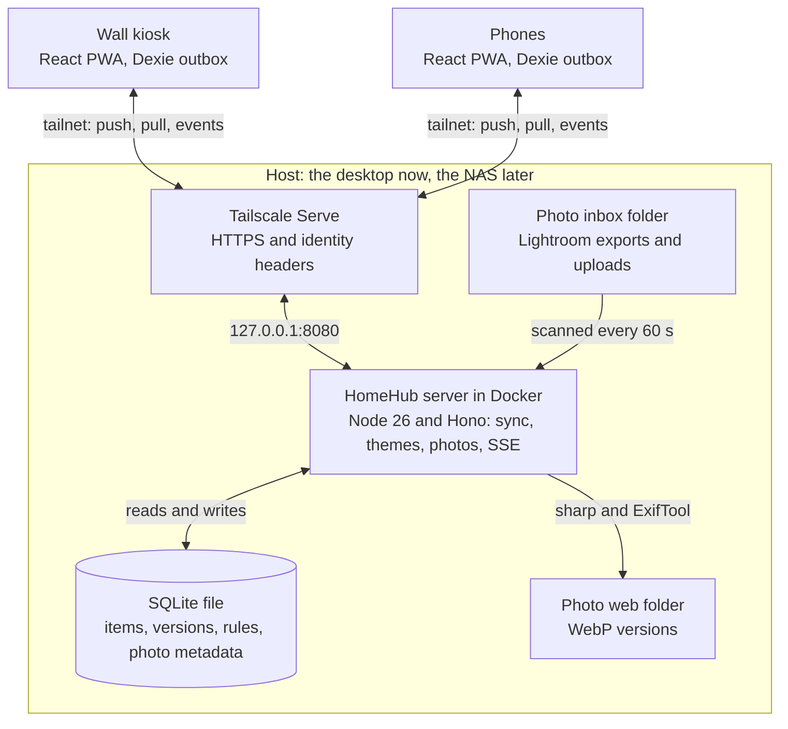

# HomeHub — Project Overview

Nov 23, 2026 · Ethan

## Summary

HomeHub is a family dashboard for a 21.5-inch touchscreen in our entryway, with a companion app on both of our phones. It has three core features:

- **Grocery list:** works with no signal in the store and syncs when service returns.
- **Photo display:** shows my wife's Canon photography, fed from her Lightroom exports.
- **Holiday countdown:** upcoming holidays with artwork and quotes, plus seasonal and holiday color themes across the app.

HomeHub is a passion project that I'll run and maintain for years. Claude Code writes most of the code and merges it after a review from the HomeHub claude.ai project, while I act as architect. It is no longer my portfolio project, because my career focus is moving to C++ and AI security. It costs $0 to run, and it's never on the public internet: every device reaches it over Tailscale.

## Goals and constraints

Every choice below is measured against these five goals.

- **Reliable every day:** the list works in a dead zone, and the wall runs unattended.
- **$0 to run:** free tiers and hardware we already own. The only paid tool is the Claude plan I already have, which Claude Code uses.
- **Best fit for each part:** each tool is picked for the job and the hardware it runs on: a 120Hz wall display, two phones, a Windows desktop now and a Ryzen NAS later.
- **Maintainable for years by one person with AI help:** one language, few dependencies, a database that's just a file, and long-term-support runtimes.
- **Private by design:** no public endpoint, no passwords and no cloud database.

## Users, devices and environments

Two people use HomeHub on two screen sizes: the entryway wall display and our phones.

| Item | Details |
| --- | --- |
| Users | Me and my wife |
| Wall display | UPERFECT 21.5-inch 120Hz touchscreen, landscape, 1920x1080 |
| Wall computer | A mini PC mounted under the display, running a browser in kiosk mode. Not bought yet; the desktop drives the display until then |
| Phones | The installable web app (PWA), opened from HomeHub's Tailscale address. Both phones run Tailscale |
| Desktop PC | Windows 11. Lightroom runs here, and it hosts HomeHub in Docker until the NAS is ready |
| NAS (being built) | Ryzen 5 7600X, 16 GB DDR5-6000 (2x8 GB), GIGABYTE B650M GAMING PLUS WIFI (Wi-Fi 6E, 2.5GbE) and a tower cooler; it still needs a case, power supply and drives. Ubuntu Server 26.04 LTS with Docker. It takes over hosting in Phase 7 |
| Network | One Tailscale tailnet (the free Personal plan) joining the server, the wall and both phones |
| Development | VS Code with the Claude Code extension, on the desktop |

My background is about 3.5 years of Blazor/.NET and 8 months of SQL Server. Tools are chosen as the best fit for each job, not by familiarity.

## Feature requirements

The first release covers the wall display, grocery list, photos and holiday themes; extra tiles come later.

### Wall display

- Landscape bento grid that shows every module at once; tapping a card opens it full screen.
- Sleeps from 12 AM to 6 AM: a black screen in the app that wakes on touch, and the display turned off by the OS.
- Room for future tiles: weather, chores and a security camera.

### Grocery list

- Each item has a name, category (aisle), quantity, store and notes.
- A persistent catalog of the staples we buy, ranked by how often we buy them.
- The wall is mostly for adding: a quick-add grid of top staples by category, one tap each. Full editing works on both screens.
- The phone is mostly for checking off in the store: "Start shopping at [store]" filters to that store and groups items by aisle.
- Works with no signal and syncs automatically when service returns.
- A Shopping Mode banner on the wall while someone is at the store, so the person at home calls with urgent items instead of adding them.

### Photos

- Path: Canon camera, then the desktop, then Lightroom, then an export into HomeHub's inbox folder.
- Landscape (3:2) photos fill the photo tile as one hero image.
- Portrait (2:3) photos are paired side by side with another portrait that shares a tag, so nothing is cropped or letterboxed.
- A small placard shows the camera settings (camera, focal length, aperture, shutter speed, ISO) and tags.
- Lightroom keyword tags (such as fall, halloween, favorites) weight the rotation toward the current season.
- A drag-and-drop upload in the browser as a backup path.

### Holiday countdown and themes

- A countdown to upcoming holidays with artwork (emoji or images) and holiday quotes. No holiday lists for now.
- Four seasonal themes that switch on calendar dates.
- Major holidays override the season: Halloween (all of October), Thanksgiving, Christmas and New Year's, and the 4th of July.

### Access

- Full use of the dashboard away from home, over Tailscale. Nothing is reachable from the public internet.

## Technology stack

One language, TypeScript, runs from the wall to the database, with one server process, one SQLite file and one container.



Phones and the wall only ever talk to Tailscale Serve on the host, and Serve is the only thing that talks to the server.

| Layer | Choice | Why |
| --- | --- | --- |
| Language | TypeScript 6.0, end to end | One language and one toolchain. Schemas and sync logic are shared, and erasable syntax lets Node run the server without a build step |
| Front end | React 19.3, Vite 8, Tailwind CSS 4, Motion, React Router 8 | Smooth 120Hz animation on the wall; one app with a wall layout and a phone layout |
| PWA | vite-plugin-pwa (Workbox) | Installs from the browser on iPhone and Android, loads offline and caches photos |
| Offline storage | Dexie 4 (IndexedDB) | The single local source of truth on every client, including the wall |
| Server | Node.js 26 LTS with Hono 4 | Node runs TypeScript directly and is supported until April 2029. Hono is small and built on web standards, with typed routes, validation, SSE and security middleware |
| Contracts | Zod 4 schemas in src/shared and Hono's typed client | The client's types come from the server's routes, so the two can't drift, and there's no code generation |
| Database | SQLite through better-sqlite3 13 | One file and no database server to run or upgrade. It's the fastest option for a single process, and its prebuilt binaries keep working across Node upgrades |
| Real-time | Server-Sent Events | A contentless "pull now" nudge over plain HTTP; browsers reconnect on their own |
| Photos | sharp (libvips) and exiftool-vendored (ExifTool) | Fast WebP versions, and ExifTool reads Canon EXIF data and Lightroom keywords reliably |
| Dates and themes | Temporal (built into Node 26) in America/New_York | Correct local holiday dates without a date library |
| Access and identity | Tailscale Personal (free) and Tailscale Serve | HTTPS on our own devices only: no open ports, no passwords and no sign-in code |
| Hosting | One Docker image: Docker Desktop on the desktop now, Docker Engine on the NAS later | The same image and data folder on both hosts |
| CI/CD | GitHub Actions on a public repo, GitHub Container Registry, and a scheduled pull on the host | Free, and the host needs no inbound access and no CI runner |
| Testing | Vitest (with Testing Library and fake-indexeddb) and Playwright (with axe) | Fast unit tests, plus real-browser tests of offline sync, themes and accessibility |
| Logging | pino JSON logs, read with Docker | Structured logs with nothing extra to run |
| AI tooling | Claude Code in VS Code, with CLAUDE.md, project rules and a review skill | Claude writes the code inside guardrails I set |

Version notes, checked November 23, 2026:

- Node.js 26 has been the Active LTS release since October 28, 2026. It moves to maintenance in October 2027 and reaches end of life on April 30, 2029. Node.js 27, the first line under Node's new one-release-a-year schedule, becomes LTS in October 2027, so upgrade after that.
- TypeScript 6.0 is the last JavaScript-based compiler. TypeScript 7.0, the native compiler released in July 2026, ships no API yet, so typescript-eslint can't run on it. Switch once typescript-eslint supports TypeScript 7.1, which is in beta.
- node:sqlite is still a release candidate in Node 26, so better-sqlite3 stays until it's stable. Drizzle ORM 1.0 is also still a release candidate; plain SQL keeps the dependency list short.
- Watchtower, the usual container auto-updater, was archived in December 2025, so the host pulls new images with a scheduled `docker compose pull`.
- Current majors on npm: React 19.3, React Router 8 (react-router-dom is gone; import from react-router), Vite 8, Vitest 5, vite-plugin-pwa 2, Motion 14, Tailwind CSS 4, Hono 4, Zod 4, Dexie 4 and better-sqlite3 13. Dependabot keeps the minor versions current.

## Access: private by design

HomeHub never listens on the internet. Every device joins one Tailscale tailnet, and Tailscale connects them directly, or through its relays when a direct path isn't possible, without opening any router ports.

- **Publishing:** the host runs Tailscale and publishes the app with Tailscale Serve, which forwards `https://homehub.<tailnet>.ts.net` to `http://127.0.0.1:8080`. Serve gets a real HTTPS certificate, so phones can install the PWA, and with `--bg` the setting survives reboots.
- **A stable address:** rename the desktop "homehub" in the Tailscale admin console now. In Phase 7 the desktop takes another name and the NAS takes "homehub", so the address, the installed apps and their offline data never change. Machine names appear in public Certificate Transparency logs when the certificate is issued, so keep them plain.
- **Identity without sign-in:** for each request from a user's device, Serve adds Tailscale-User-Login, Tailscale-User-Name and Tailscale-User-Profile-Pic headers. The server accepts only logins on its ALLOWED_USERS list, and it listens only on 127.0.0.1, so nothing reaches it without passing through Serve. There are no passwords, sign-in screens or tokens, so an expired session can never strand the offline outbox.
- **The wall:** the wall's computer signs in to Tailscale as one of us, so the app also records a device name, such as "wall", to show where a change came from.
- **Phones stay connected:** Android uses always-on VPN, with "Block connections without VPN" left off. iPhone uses VPN On Demand, set to Always for both Wi-Fi and cellular.
- **Key expiry:** turned off for the server and the wall, so they never drop off the tailnet, and left on for phones.
- **My wife's devices:** invite her to the tailnet as a second user; the Personal plan allows up to six.
- **The catch:** the host must be on. While the desktop is the host, it must never sleep.

The dead-zone scenario, step by step:

1. At home, my wife taps Eggs on the wall. The wall writes the item and an AddItem intent to its local database, pushes it over the tailnet, and the server commits version 1042 and sends every connected device a "pull now" event.
2. In the back of the store, with no signal, I check off Milk. My phone writes the change locally and queues a MarkPurchased intent; nothing is sent.
3. In the parking lot, my phone's Tailscale reconnects over cellular. The sync manager pushes MarkPurchased, which the server applies, then pulls everything since its cursor (including Eggs), then re-applies anything still queued.
4. The wall gets the nudge and pulls, and Milk shows as checked off.

At no point is the server exposed: my phone reached it over the encrypted tailnet.

## Grocery sync design

Every client writes to a local database first and syncs through an outbox, so the list works with no signal and nothing is lost.

### Client (phones and wall)

- IDs are UUIDv7, generated with the npm uuid package's v7(); crypto.randomUUID() only makes v4.
- Each change and its outbox entry are saved in one Dexie transaction.
- Changes are recorded as intents, not overwrites: AddItem, MarkPurchased, NeedAgain, SetQuantity, EditNotes, DeleteItem.
- One reducer in src/shared defines what each intent does. The client uses it to apply changes locally, and the server uses the same function, so the two can't disagree.
- The outbox flushes shortly after each local change, on the online event, on visibilitychange, on a 30-second heartbeat while the app is open, and when a "pull now" event arrives. iOS Safari has no Background Sync API, so syncing only happens with the app open.
- After a pull, unsent intents are re-applied on top of the server's rows, so local changes aren't overwritten.
- A rejected change, such as checking off an item someone deleted, leaves the outbox and shows in the UI.
- The wall uses the same outbox, so items added while the server is unreachable aren't lost.

Example outbox entry. The mutationId doubles as the idempotency key, so a retried push is never applied twice.

```json
{
  "mutationId": "019ab2c4-...",
  "itemId": "019ab2a0-...",
  "intent": "MarkPurchased",
  "occurredAt": "2026-11-28T16:10:00Z",
  "device": "ethan-phone"
}
```

### Server

- POST /api/grocery/sync/push applies a batch of mutations in order, in one transaction, and returns a result for each: applied, duplicate or rejected.
- GET /api/grocery/sync/pull?since={version} returns every row changed after the client's cursor, including deleted rows (tombstones), plus the new cursor and the current shopping session.
- GET /api/events is a Server-Sent Events stream. After a commit that changed something, every connected client gets a `changed` event with no row data; data always travels through the pull endpoint.
- Tables: grocery_items, catalog_items (Phase 4), stores, shopping_sessions, processed_mutations (each mutation ID with its result) and sync_state.

**Versioning.** Each push runs in one SQLite transaction that bumps a single counter row and stamps every changed row with the new version:

```sql
UPDATE sync_state SET version = version + 1 WHERE id = 1 RETURNING version;
```

SQLite allows one writer at a time, and better-sqlite3 runs each transaction synchronously, so versions are committed strictly in order and a client's cursor can never skip a row. The old PostgreSQL design needed a row lock to get this guarantee; SQLite gives it for free, as long as the bump and the writes share one transaction (SYNC-5).

### Shopping Mode

- A server-side lease in shopping_sessions (started by, store, started at, expires at, ended at), not tied to the phone's connection, which drops in the store.
- Starts when the shopper taps "Start shopping at [store]" while they still have signal, at home or in the parking lot. It can't be queued offline, because a late start would show a stale banner, so the button says so when the phone is offline.
- Ends when the shopper taps Done, when someone taps "We're home" on the wall banner, or 2 hours after the shopper's last sync.
- Every pull includes the current session, and starting or ending one sends a "pull now" event.
- Wall banner text: "Shopping at [store]. Call before adding urgent items."

## Photo pipeline and display

Photos go from a Lightroom export to the wall through one inbox folder and one processing path on the server.

1. My wife exports from Lightroom into HomeHub's inbox with a saved export preset: JPEG, sRGB, long edge about 3,000 pixels, and metadata set to All Metadata with Remove Location Info checked. "Copyright Only" strips the keywords and camera data the app needs.
2. The inbox is a folder on the host: a local folder on the desktop now, bind-mounted into the container, and a Samba share on the NAS later, so Lightroom on the desktop exports straight into it.
3. Every 60 seconds the server scans the inbox and takes only files whose size hasn't changed since the previous scan, so it never grabs a half-written export. Polling works on Docker Desktop bind mounts and network shares, where file-change events are unreliable.
4. For each new file, the server hashes it to skip duplicates and reads the EXIF, IPTC and XMP data with exiftool-vendored: camera, lens, focal length, aperture, shutter speed, ISO, date taken and keywords. Then sharp makes two auto-rotated WebP versions with all metadata stripped: one that fits 1920x1080 for the wall and a 400-pixel thumbnail for phones.
5. Metadata goes into SQLite, the WebP files go into the web folder, the original moves to originals, and the photo joins the rotation. A file that fails moves to failed, with the reason logged.
6. The browser drag-and-drop upload saves into the same inbox, so there's only one processing path.

The data volume on the host:

```text
data/
├── homehub.db            # plus homehub.db-wal and homehub.db-shm
├── backups/
└── photos/
    ├── inbox/            # Lightroom exports and browser uploads land here
    ├── originals/        # processed originals
    ├── failed/           # files that couldn't be processed
    └── web/<id>/         # wall.webp and thumb.webp, served at /media/photos/<id>/
```

Display rules:

- Landscape photos fill the tile. A portrait is always shown beside a second portrait, one that shares a keyword when there is one.
- The placard sits on a semi-opaque gradient, never a CSS backdrop-filter blur, which stutters on mini PC graphics.
- Photos whose keywords match the active theme or season are four times as likely to come up, and favorites twice as likely.
- Transitions crossfade with opacity only, and the next image is preloaded so a transition never waits on the network.
- The service worker caches the images, so the wall keeps cycling during an outage.

## Holiday and seasonal theme engine

Themes are data, not code: each season and holiday is a row in theme_rules, seeded by a migration, so adding one never touches the engine.

Each rule has a key, a kind (season or holiday), a type (fixed date, nth weekday or computed), lead and trail days, a priority, artwork and quotes. The highest-priority active rule wins, and the web app applies it through CSS custom properties (design tokens).

| Theme | Rule | Window | Priority |
| --- | --- | --- | --- |
| Spring, Summer, Fall, Winter | Fixed start dates; default Mar 20, Jun 21, Sep 22, Dec 21 | Until the next season starts | 10 |
| Halloween | Fixed: Oct 31 | 30 lead days (all of October) | 100 |
| Thanksgiving | Nth weekday: 4th Thursday of November | 6 lead days (Nov 20 to 26 in 2026) | 100 |
| Christmas | Fixed: Dec 25 | 24 lead days (Dec 1 to 25) | 100 |
| New Year's | Fixed: Jan 1 | 6 lead days (Dec 26 to Jan 1) | 100 |
| 4th of July | Fixed: Jul 4 | 5 lead days, 1 trail day (Jun 29 to Jul 5) | 100 |
| Easter (optional) | Computed | To decide | 100 |

How it runs:

- The server turns the clock's instant into a local date in HOME_TZ (America/New_York) with Temporal, then evaluates each rule for last year, this year and next year, so windows that cross New Year's work.
- GET /api/themes/current returns the active theme (key, name, artwork and quotes), the next few holidays with their dates, and nextChangeAt, the next local midnight when the answer can change. Clients cache it in Dexie, switch at nextChangeAt, and keep the last theme while offline.
- The web app applies a theme by setting data-theme on the html element; each theme is one block of CSS custom properties.
- Themes are never calculated in UTC. The container runs on UTC, and a UTC calculation would end Halloween at 8 PM on Halloween night. Node 26 ships full time zone data, so the slim image needs nothing extra.

Tests:

- Vitest with a fixed clock: 9 PM on Oct 31 is still Halloween, Nov 2 is Fall, Thanksgiving week is right for 2026 and 2027, the Dec 31 to Jan 1 crossing works, and the daylight-saving change days behave.
- Playwright stubs the theme endpoint once per theme, then takes a screenshot and runs an axe scan.

## Wall kiosk setup

Until the mini PC arrives, the UPERFECT is a second screen on the desktop, running the installed HomeHub app full screen at /wall. After that, the mini PC under the display runs a browser in kiosk mode, locked down so a stray swipe or pinch can't break it. Chromium launch flags:

```text
--kiosk --noerrdialogs --disable-pinch --overscroll-history-navigation=0 --disable-features=TouchpadOverscrollHistoryNavigation
```

- Cabling: if the mini PC has USB-C with DisplayPort output, one cable carries picture and touch. Otherwise use HDMI plus a USB cable for touch.
- CSS: touch-action: manipulation on the whole app, to stop double-tap zoom.
- Startup and recovery: sign in automatically, start the browser at boot, and relaunch it if it crashes.
- Maintenance: schedule OS updates inside the 12 AM to 6 AM sleep window, and reload the page nightly to pick up new deploys.
- Night mode: the app shows a black screen at midnight that wakes on touch, and the OS turns the display off until 6 AM. The exact commands depend on the mini PC's OS.
- Access: the mini PC joins the tailnet signed in as me, with key expiry off, and I fix it remotely over Tailscale SSH on Linux or Remote Desktop on Windows Pro.

## Hosting, deployment and backups

HomeHub runs as one container on the desktop now and moves to the NAS later, with the same image and the same data folder.

**Now: the desktop.** Docker Desktop (WSL 2 backend, free for personal use) starts at sign-in, and Tailscale for Windows runs Serve. A deploy folder such as C:\HomeHub holds compose.yaml, .env and the data folder, on a local disk and never in OneDrive (DATA-9). The desktop must not sleep, and after a Windows Update restart HomeHub comes back once someone signs in.

**Later: the NAS.** Ubuntu Server 26.04 LTS with Docker Engine and the Compose plugin, Tailscale, a Samba share for the photo inbox, mirrored data drives and a systemd timer in place of the Windows scheduled task.

Deploying:

1. A pull request merges to main.
2. GitHub Actions builds the image and pushes ghcr.io/<you>/homehub with two tags: main and sha-<commit>. The package is public, so the host pulls without credentials.
3. Every 5 minutes, the host's scheduled task runs `docker compose pull` and then `docker compose up -d`. Compose restarts the container only when the image changed.
4. On start, the server backs up the database, applies any new migrations, and reports the new commit at /api/health.

To roll back, set HOMEHUB_TAG to an older sha- tag in .env and run `docker compose up -d`. Migrations only add tables and columns (DATA-11), so the previous image still runs. There's no self-hosted CI runner: the repo is public, and a fork's pull request could run code on it.

Backups:

- Before every migration, automatically (DATA-4).
- Nightly at 3 AM, an online backup into data/backups, keeping 14 daily and 8 weekly copies.
- Off-site from Phase 7: a weekly copy encrypted with rclone crypt to a free cloud drive. Until then, copy the backups to a second local drive. Photo originals also live in Lightroom, and the web versions can be regenerated.
- Test a restore after any change to the backup code, and every few months anyway.

Monitoring: /api/health and the wall's status tile show the version, database status, last photo scan and last backup. Docker restarts the container if it crashes and marks it unhealthy if the health check fails. In Phase 7, an optional free Healthchecks.io check emails me if the NAS stops reporting in.

## Repository layout

One repository and one npm package; Node runs the server's TypeScript directly, and Vite builds the web app.

```text
homehub/
├── CLAUDE.md                  # Claude Code's instructions; imports docs/coding-standards.md
├── .claude/
│   ├── settings.json          # permissions (AI-7)
│   ├── rules/sync.md          # loaded when Claude touches sync files
│   └── skills/standards-review/SKILL.md
├── .github/                   # CI workflow, Dependabot, PR template
├── docs/
│   ├── project-overview.md
│   ├── coding-standards.md
│   ├── build-plan.md
│   └── adr/                   # Architecture Decision Records
├── src/
│   ├── shared/                # Zod schemas, intents, intent reducer (pure TypeScript)
│   ├── server/
│   │   ├── main.ts            # composition root: config, database, app, jobs, shutdown
│   │   ├── app.ts             # the Hono app; exports AppType
│   │   ├── config.ts
│   │   ├── db/                # connection, migrator, migrations/*.sql, backups
│   │   ├── middleware/        # identity, errors, request IDs, logging
│   │   └── features/          # grocery, shopping, photos, themes, status
│   └── web/                   # React PWA (Vite root, its own tsconfig.json)
│       ├── app/               # router, wall and phone layouts, error boundaries
│       ├── data/              # Dexie database, sync manager, API client, live-query hooks
│       ├── features/          # grocery, photos, themes, shopping, status
│       ├── components/
│       └── styles/            # Tailwind entry and theme tokens
├── tests/e2e/                 # Playwright
├── deploy/                    # Windows update script; NAS systemd units
├── Dockerfile
├── compose.yaml
└── package.json
```

## Testing strategy

Tests target the riskiest parts first: sync correctness, time logic and the offline flow. All of them run in GitHub Actions on every push.

| Level | Tools | Key cases |
| --- | --- | --- |
| Shared | Vitest | Each intent's normal case and edge cases; the reducer gives the same answer on client and server |
| Server | Vitest, real SQLite in memory, `app.request()` | Replayed mutations apply once; every changed row gets the new version; pulls return tombstones; identity and same-origin rules; theme dates in America/New_York |
| Client | Vitest, fake-indexeddb, Testing Library | A change and its outbox entry save together; rebase after a pull; rejected mutations leave the outbox; loading, empty, offline and error states |
| End to end | Playwright (wall in Chromium, iPhone in WebKit, Android in Chromium), axe | Check items off offline, reconnect and see it on the wall; add on the wall while the server is down; each theme renders and passes axe; the app installs and loads offline |

## Working with Claude Code

Claude Code writes the code, tests and config, and takes each change from branch to merge. I decide the design, and the HomeHub claude.ai project reviews every pull request.

- **Editor:** VS Code with the Claude Code extension. There's no official Claude Code extension for Visual Studio; there, you'd run the CLI in its terminal and lose the inline diffs and plan review.
- **Context:** CLAUDE.md imports the coding standards; docs/ holds this overview, the build plan and the ADRs; .claude/rules/sync.md adds the sync rules whenever Claude works on sync files; .claude/settings.json holds the permissions.
- **The loop for each build-plan step:** start a fresh session and paste the step's prompt. Claude implements test-first, runs `npm run check`, opens a pull request (risky steps start its description with a short plan) and says it's ready. I ask the HomeHub claude.ai project to review the pull request by its number, then paste the review back with an instruction to merge. Claude fixes the Blockers and, once CI passes, squash-merges; the merge deploys itself, and I check it on a phone or the wall.
- **Not delegated:** design decisions (ADRs), secrets, the Tailscale admin console, and the host's power and Docker settings.
- **An AI-security lab on the side:** HomeHub is a safe place to practice least-privilege permissions for an agent and to notice prompt-injection surfaces, such as web pages, issue text, package READMEs and EXIF strings.

## Decision records

Write these ADRs first, each with the alternatives considered:

1. ADR-0001: Record architecture decisions.
2. ADR-0002: One TypeScript stack on Node 26, replacing .NET, Aspire, PostgreSQL and Azure.
3. ADR-0003: SQLite through better-sqlite3, over PostgreSQL and node:sqlite.
4. ADR-0004: Tailscale-only access with identity headers, over public hosting and OIDC sign-in.
5. ADR-0005: Intent outbox sync with a counter version.
6. ADR-0006: Pull-based deployment from GHCR, with no self-hosted runner.
7. ADR-0007: Server-side theme engine with Temporal in HOME_TZ.
8. ADR-0008: A polled photo inbox, over file-system watchers.

## Roadmap

The first goal is a walking skeleton on both phones and the wall by the end of Thanksgiving weekend; everything else layers on after.

### Phase 0: Accounts, tools and Claude Code (this week)

- [ ] GitHub and Tailscale accounts, desktop tools, Claude Code in VS Code
- [ ] Tailscale on the desktop and both phones, with the desktop named homehub

### Phase 1: Walking skeleton (Thanksgiving weekend)

- [ ] Repo, scaffold, database and migrations, identity and security middleware
- [ ] App shell and PWA, test harnesses, CI
- [ ] Docker image, pull-based deploy on the desktop, Tailscale Serve
- [ ] Installed on both phones and the UPERFECT

### Phase 2: Grocery list with offline sync (in daily use by mid-December)

- [ ] Shared intents and reducer, push and pull endpoints, Dexie outbox, rebase, SSE nudge
- [ ] Phone and wall grocery screens
- [ ] Proof: a real shopping trip with no signal syncs afterwards

### Phase 3: Holiday countdown and themes (Christmas theme live before Christmas)

- [ ] Rules engine with time zone handling and tests
- [ ] Palettes, countdown card, theme tests

### Phase 4: Grocery features

- [ ] Catalog and quick-add staples grid
- [ ] Store and aisle grouping for shopping trips
- [ ] Shopping Mode lease and wall banner

### Phase 5: Photos

- [ ] Inbox scanner, metadata and WebP versions
- [ ] Hero and diptych layout with placards, drag-and-drop upload

### Phase 6: Wall hardware (whenever the mini PC is ready)

- [ ] Mini PC kiosk, night mode, a week unattended

### Phase 7: Move to the NAS (when it's built)

- [ ] NAS host, data moved, the homehub name moved, off-site backups

Later: weather, chores and security camera tiles.

## Open decisions

Eight choices are still open; each one changes how part of the build is done.

- [ ] Mini PC model and OS: decides the kiosk setup and how the display turns off at night.
- [ ] iPhone or Android for each of us: decides the Tailscale always-on steps and which Playwright project matters most.
- [ ] Lightroom Classic or Lightroom (cloud): decides how the export preset is set up.
- [ ] Season start dates: astronomical-style (Mar 20) or meteorological (Mar 1).
- [ ] Christmas window: Christmas Dec 1 to 25 and New Year's Dec 26 to Jan 1 (the default), or one combined theme.
- [ ] Processed originals: keep them (the default) or delete them to save space.
- [ ] NAS drives and mirroring, and the off-site backup target: a free cloud drive through rclone crypt, or a USB drive kept elsewhere.
- [ ] Tailnet access rules: keep the default policy, which lets every device reach every other, or add a grant so our devices can reach only HomeHub's HTTPS port.

## Cost watch-list

Everything HomeHub needs is free; the only paid tool is the Claude plan I already have.

| Item | Cost | Watch |
| --- | --- | --- |
| Tailscale Personal | Free for up to 6 users | Stay within the free plan's limits |
| GitHub (Actions, Container Registry, CodeQL, Dependabot, secret scanning) | Free for a public repo | Keep the repo and the image package public |
| Docker Desktop | Free for personal use | Docker Engine on the NAS is free and open source |
| Off-site backup (Phase 7) | A cloud drive's free tier | Database backups are small; photo originals stay in Lightroom |
| Electricity | The desktop stays on until the NAS takes over | One more reason to finish the NAS |
| Claude Code | Uses my existing Claude plan | Not a HomeHub running cost |

Every dependency that ships in the image uses MIT, Apache-2.0 or a similarly permissive license (GEN-9); keep it that way. Two build- and test-time tools that never ship use MPL-2.0: lightningcss (through Tailwind and Vite) and axe-core (through eslint-plugin-jsx-a11y).

## Sources

The version, platform and pricing facts above come from these pages, checked on November 23, 2026.

- [Evolving the Node.js release schedule](https://nodejs.org/en/blog/announcements/evolving-the-nodejs-release-schedule) (Node 26 and 27 support dates)
- [Node.js: running TypeScript natively](https://nodejs.org/api/typescript.html)
- [Announcing TypeScript 6.0](https://devblogs.microsoft.com/typescript/announcing-typescript-6-0/)
- [Announcing TypeScript 7.0](https://devblogs.microsoft.com/typescript/announcing-typescript-7-0/)
- [typescript-eslint and TypeScript 7 (issue #12518)](https://github.com/typescript-eslint/typescript-eslint/issues/12518)
- [better-sqlite3 releases](https://github.com/WiseLibs/better-sqlite3/releases)
- [Hono RPC](https://hono.dev/docs/guides/rpc), [validation](https://hono.dev/docs/guides/validation), [streaming helpers](https://hono.dev/docs/helpers/streaming) and [CSRF middleware](https://hono.dev/docs/middleware/builtin/csrf)
- [Announcing Vite 8](https://vite.dev/blog/announcing-vite8) and [vite-plugin-pwa 1.3.0 (Vite 8 support)](https://newreleases.io/project/npm/vite-plugin-pwa/release/1.3.0)
- [Tailscale Serve](https://tailscale.com/docs/features/tailscale-serve) and the [serve command](https://tailscale.com/docs/reference/tailscale-cli/serve)
- [Tailscale: enabling HTTPS](https://tailscale.com/kb/1153/enabling-https) (certificates and Certificate Transparency logs)
- [Tailscale key expiry](https://tailscale.com/docs/features/access-control/key-expiry)
- [Tailscale VPN On Demand for iOS](https://tailscale.com/docs/features/client/ios-vpn-on-demand)
- [Tailscale pricing](https://tailscale.com/pricing)
- [Configuring a package's access control and visibility (GHCR)](https://docs.github.com/en/packages/learn-github-packages/configuring-a-packages-access-control-and-visibility)
- [Watchtower reaches end of maintenance](https://linuxiac.com/docker-update-tool-watchtower-reaches-end-of-maintenance/)
- [Canonical releases Ubuntu 26.04 LTS](https://canonical.com/blog/canonical-releases-ubuntu-26-04-lts-resolute-raccoon)
- [Claude Code: skills](https://code.claude.com/docs/en/skills), [permissions](https://code.claude.com/docs/en/permissions) and [the .claude directory](https://code.claude.com/docs/en/claude-directory)
