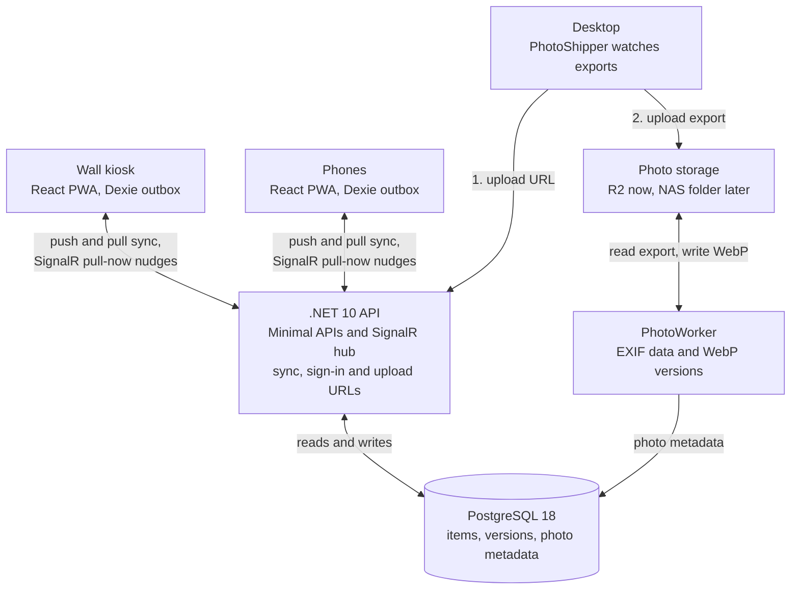

# HomeHub — Project Overview

Oct 15, 2026 · Ethan

## Summary

HomeHub is a family dashboard for a 21.5-inch touchscreen in our entryway, with a companion app on both of our phones. It has three core features:

- **Grocery list:** works with no signal in the store and syncs when service returns.
- **Photo display:** shows my wife's Canon photography, fed from her Lightroom exports.
- **Holiday countdown:** upcoming holidays with artwork and quotes, plus seasonal and holiday color themes across the app.

It has two jobs: a reliable daily tool for our household, and my flagship portfolio project for senior or lead developer and solutions architect roles. Everything must cost $0, using free tiers and student credits now and a home NAS later.

## Users, devices and environments

Two people use HomeHub on two screen sizes: the entryway wall display and our phones.

| Item | Details |
| --- | --- |
| Users | Me and my wife |
| Wall display | UPERFECT 21.5-inch 120Hz touchscreen, landscape, 1920x1080 |
| Wall computer | Mini PC mounted under the display, running Chromium in kiosk mode |
| Phones | Installable web app (PWA): no app store fees, works offline |
| Desktop PC | Where photos are offloaded and Lightroom runs |
| Planned NAS | A desktop machine set up as a NAS that will also host the app |
| Hosting | Phase 1: Azure on my student account. Phase 2: the home NAS |

My background is about 3.5 years of Blazor/.NET and 8 months of SQL Server. Tools are chosen as the best fit for each job, not by familiarity.

## Feature requirements

The first release covers the wall display, grocery list, photos and holiday themes; extra tiles come later.

### Wall display

- Landscape bento grid that shows every module at once; tapping a card opens it full screen.
- Sleeps from 12 AM to 6 AM: a black screen in the app that wakes on touch, and the display turned off by the OS.
- Room for future tiles: weather, chores and a security camera.

### Grocery list

- Each item has a name, category (aisle), quantity, store and notes.
- A persistent catalog of the staples we buy, ranked by how often we buy them.
- The wall is mostly for adding: a quick-add grid of top staples by category, one tap each. Full editing works on both screens.
- The phone is mostly for checking off in the store: "Start shopping at [store]" filters to that store and groups items by aisle.
- Works with no signal and syncs automatically when service returns.
- A Shopping Mode banner on the wall while someone is at the store, so the person at home calls with urgent items instead of adding them.

### Photos

- Path: Canon camera, then the desktop, then Lightroom, then an export folder.
- Landscape (3:2) photos fill the photo tile as one hero image.
- Portrait (2:3) photos are paired side by side with another portrait that shares a tag, so nothing is cropped or letterboxed.
- A small placard shows the camera settings (camera, focal length, aperture, shutter speed, ISO) and tags.
- Lightroom keyword tags (such as fall, halloween, favorites) weight the rotation toward the current season.
- A drag-and-drop upload in the browser as a backup path.

### Holiday countdown and themes

- A countdown to upcoming holidays with artwork (emoji or images) and holiday quotes. No holiday lists for now.
- Four seasonal themes that switch on calendar dates.
- Major holidays override the season: Halloween (all of October), Thanksgiving, Christmas and New Year's, and the 4th of July.

### Access

- Full use of the dashboard away from home, not only on home Wi-Fi.

## Technology stack

The stack is .NET 10 with Aspire, React 19 and PostgreSQL 18, each picked as the best fit that costs nothing.



Phones and the wall sync through the API, while photo uploads go straight to storage and the worker processes them.

| Layer | Choice | Why |
| --- | --- | --- |
| Front end | React 19, TypeScript, Vite, Tailwind CSS v4, Motion (formerly Framer Motion); PWA service worker | Smooth animation on the wall and offline use on phones; one app with a wall layout and a phone layout |
| Offline storage | Dexie.js (IndexedDB) | The single local source of truth on every client, including the wall |
| Back end | .NET 10 Minimal APIs, Clean Architecture | .NET 10 is the current LTS release, supported through November 2028 |
| Commands and queries | Our own ICommandHandler and IQueryHandler interfaces | Avoids MediatR, which is dual-licensed from version 13 |
| Real-time | SignalR | Sends only a "pull now" nudge, never data |
| Orchestration | Aspire (AppHost and ServiceDefaults) | Runs everything locally with an OpenTelemetry dashboard, deploys to Azure, and publishes Docker Compose for the NAS |
| Database | PostgreSQL 18 | Native uuidv7() and JSONB for photo metadata |
| Photo storage | IPhotoStorageProvider: Cloudflare R2 now, a local folder on the NAS later | MinIO's open-source edition is archived; Garage isn't needed |
| Image processing | MetadataExtractor (EXIF, IPTC) and SixLabors.ImageSharp (WebP) | ImageSharp is Apache 2.0 for open-source projects |
| Sign-in | OIDC on phones (Entra External ID or Auth0, to decide) and a device credential for the wall | Standard identity, no passwords typed on the wall |
| Remote access (NAS phase) | Cloudflare Tunnel | HTTPS from anywhere without opening router ports |
| CI/CD | GitHub Actions, Docker, openapi-typescript | TypeScript types generated from the API's OpenAPI document, so the two sides can't drift |
| Testing | xUnit, Testcontainers, Vitest with fake-indexeddb, Playwright | See the testing strategy below |

Version notes: .NET 9 support ends November 10, 2026, and .NET 11 launches that same week as a short-term support release, so the project stays on .NET 10. PostgreSQL 19 is planned for general availability on November 19, 2026; revisit the upgrade after it ships.

## Grocery sync design

Every client writes to a local database first and syncs through an outbox, so the list works with no signal and nothing is lost.

### Client (phones and wall)

- IDs are UUIDv7, generated with the npm uuid package's v7(); crypto.randomUUID() only makes v4.
- Each change and its outbox entry are saved in one Dexie transaction.
- Changes are recorded as intents, not overwrites: AddItem, MarkPurchased, NeedAgain, SetQuantity, EditNotes, DeleteItem.
- The outbox flushes on the online event, on visibilitychange, and on a 30-second heartbeat while the app is open. iOS Safari has no Background Sync API, so syncing only happens with the app open.
- After a pull, unsent intents are re-applied on top of the server's rows, so local changes aren't overwritten.
- Unsent changes survive an expired session and a new sign-in.
- The wall uses the same outbox, so items added during a home internet outage aren't lost.

Example outbox entry. The mutationId doubles as the idempotency key, so a retried push is never applied twice.

```json
{
  "mutationId": "0199e8b2-...",
  "itemId": "0199e7a0-...",
  "intent": "MarkPurchased",
  "occurredAtUtc": "2026-10-15T16:10:00Z"
}
```

### Server

- POST /api/grocery/sync/push applies mutations in order and returns a result for each: applied, duplicate or rejected. A rejected change, such as checking off a deleted item, leaves the outbox instead of blocking it.
- GET /api/grocery/sync/pull?since={version} returns rows newer than the client's cursor, including deleted rows (tombstones).
- After a change, SignalR tells clients to pull; data always travels through the pull endpoint.

**Versioning.** Each write transaction bumps a single counter row and stamps its rows with the new version:

```sql
UPDATE sync_state SET version = version + 1 WHERE id = 1 RETURNING version;
```

The row lock makes the next writer wait until this one commits, so versions appear in commit order. A plain sequence can skip rows: if 1048 commits after 1049, a client that already pulled 1049 never sees 1048. The bump and the data write must share one transaction; separate EF Core SaveChanges calls without an explicit transaction bring the bug back.

### Shopping Mode

- A server-side lease (ShoppingSession: started by, store, started at, expires at), not tied to the phone's live connection, which drops in the store.
- Starts when the shopper taps "Start shopping" while they still have signal, at home or in the parking lot.
- Ends when the shopper taps Done, when someone taps "We're home" on the wall banner, or after about 2 hours.
- Wall banner text: "Shopping at [store]. Call before adding urgent items."

## Photo pipeline and display

Photos go from a Lightroom export to the wall through one upload path and one server-side worker.

1. My wife exports from Lightroom to a watched folder with export metadata set to All Metadata. "Copyright Only" strips the keywords and camera data the app needs.
2. PhotoShipper, a .NET 10 Worker Service on the desktop, waits until each file finishes writing. FileSystemWatcher fires before an export is complete, so it checks that the file is stable first.
3. The shipper asks the API for a presigned upload URL and uploads the export straight to storage. Storage keys never live on the desktop.
4. The browser drag-and-drop upload uses the same presigned path.
5. After each upload, the client calls a completion endpoint so the API queues the photo for processing.
6. PhotoWorker, on the server, reads EXIF and IPTC data with MetadataExtractor and makes WebP versions with ImageSharp: 1080p for the wall and 400px thumbnails for phones.
7. Metadata goes into PostgreSQL (JSONB), and the photo joins the rotation, weighted toward tags that match the current season.

In Phase 2 the export folder lives on the NAS, so the worker watches it directly through a bind mount and the shipper retires. File watching doesn't see changes made over SMB or NFS network mounts, so a periodic scan backs it up.

Display rules:

- No CSS backdrop-filter blur on placards, because it stutters on mini PC graphics; use a semi-opaque dark gradient instead.
- Animate only transform and opacity, through Motion.
- Consider deleting each raw upload after processing to stay within free storage; Lightroom keeps the originals.

## Holiday and seasonal theme engine

Themes are data, not code: each season and holiday is a database row, so adding one is an insert, not a deploy.

Each rule has a type (fixed date, nth weekday or computed), lead and trail days, a theme key, a priority, artwork and quotes. The highest-priority active rule wins, and the theme is applied through CSS custom properties (design tokens).

| Theme | Rule | Window | Priority |
| --- | --- | --- | --- |
| Spring, Summer, Fall, Winter | Fixed dates; default Mar 20, Jun 21, Sep 22, Dec 21 | Until the next season starts | 10 |
| Halloween | Fixed: Oct 31 | 30 lead days (all of October) | 100 |
| Thanksgiving | Nth weekday: 4th Thursday of November | 6 lead days (Nov 20 to 26 in 2026) | 100 |
| Christmas and New Year's | Fixed: Dec 25 and Jan 1 | To decide, for example Dec 1 to Jan 1 | 100 |
| 4th of July | Fixed: Jul 4 | 5 lead days, 1 trail day (Jun 29 to Jul 5) | 100 |
| Easter (optional) | Computed | To decide | 100 |

Time zone rules:

- Themes are calculated in America/New_York, never UTC. Containers run on UTC, so a UTC calculation would end Halloween at 8 PM on Halloween night.
- The API's container image must include time zone data. The slim chiseled .NET images leave it out; the -extra variant and the regular Ubuntu or Debian images include it.

Tests:

- xUnit with FakeTimeProvider: 9 PM on Oct 31 is still Halloween, Nov 2 is Fall, and the New Year's window crosses Dec 31 to Jan 1 correctly.
- Playwright checks that each theme renders by stubbing the theme API response. Its clock only fakes browser time, not the server's TimeProvider.

## Wall kiosk setup

The mini PC under the display runs Chromium in kiosk mode, locked down so a stray swipe or pinch can't break it. Launch flags:

```text
--kiosk --noerrdialogs --disable-pinch --overscroll-history-navigation=0 --disable-features=TouchpadOverscrollHistoryNavigation
```

- Cabling: if the mini PC has USB-C with DisplayPort output, one cable carries picture and touch. Otherwise use HDMI plus a USB cable for touch.
- CSS: touch-action: manipulation on the whole app, to stop double-tap zoom.
- Startup and recovery: log in automatically, start the browser at boot, and relaunch it if it crashes.
- Maintenance: schedule OS updates inside the 12 AM to 6 AM sleep window, and reload the page nightly to pick up new deploys.
- Night mode: the app shows a black screen at midnight that wakes on touch, and the OS turns the display off until 6 AM. The exact commands depend on the mini PC's OS.
- Sign-in: the wall gets a revocable device credential through one-time pairing. It shows a code that one of us approves from a phone.

## Hosting and deployment

HomeHub starts on Azure with student credits and moves to the home NAS before the free database year ends.

**Phase 1: Azure.** Aspire deploys the API and workers to Azure Container Apps. The database uses AddAzurePostgresFlexibleServer().RunAsContainer(): a container on my machine and a managed Flexible Server in Azure.

- Azure for Students needs no credit card, renews yearly while I'm a student, and includes a $100 credit to use within 12 months.
- It also includes 750 hours a month of a B1MS PostgreSQL Flexible Server, free for 12 months for new Azure customers.
- Container Apps' free grant is 180,000 vCPU-seconds a month. The wall's always-open SignalR connection keeps a replica awake all month, which uses more than that, so expect a small draw on the credit.
- If the credit runs out, Azure disables the subscription instead of charging, unless I choose to move to pay-as-you-go.

**Phase 2: home NAS.** Aspire publishes Docker Compose files for the NAS. Photos switch to the local-folder storage provider, and Cloudflare Tunnel provides HTTPS from anywhere without opening router ports.

## Solution layout

The repository follows Clean Architecture, with Aspire orchestrating every service and each major decision recorded as an ADR.

```text
HomeHub/
├── docs/
│   └── adr/                       # Architecture Decision Records
├── src/
│   ├── HomeHub.AppHost/           # Aspire: local run, Azure deploy, Docker Compose publish
│   ├── HomeHub.ServiceDefaults/   # OpenTelemetry, health checks, resilience
│   ├── HomeHub.Domain/            # Entities, value objects, recurrence rules, domain events
│   ├── HomeHub.Application/       # Command and query handlers, DTOs, interfaces
│   ├── HomeHub.Infrastructure/    # EF Core 10 + PostgreSQL 18, storage providers, auth, SignalR
│   ├── HomeHub.Api/               # Minimal APIs, SignalR hub, auth policies
│   ├── HomeHub.PhotoWorker/       # Server-side EXIF extraction and WebP versions
│   ├── HomeHub.PhotoShipper/      # Desktop uploader for the Lightroom export folder
│   └── homehub-web/               # React PWA (wall and phone layouts) with Vitest tests
└── tests/
    ├── HomeHub.Domain.UnitTests/
    ├── HomeHub.IntegrationTests/
    └── HomeHub.E2E.Playwright/
```

## Testing strategy

Tests target the riskiest parts first: sync correctness, time logic and the offline flow. All of them run in GitHub Actions on every push.

| Level | Tools | Key cases |
| --- | --- | --- |
| Domain | xUnit, FakeTimeProvider | Holiday rules and windows, time zone edges, how each intent applies |
| Integration | xUnit, Testcontainers (PostgreSQL 18) | Two overlapping write transactions never skip a version; replayed mutations apply once; pulls return tombstones |
| Client | Vitest, fake-indexeddb | A change and its outbox entry save together; rebase after a pull; rejected mutations leave the outbox |
| End to end | Playwright | Check items off offline, reconnect and confirm the sync; add at the wall during an outage; each theme renders from a stubbed response |

## Roadmap

The first goal is a walking skeleton with the wall live by Thanksgiving, Nov 26, 2026; everything else layers on after.

### Phase 1: Walking skeleton

- [ ] Aspire solution, Clean Architecture projects, React PWA and GitHub Actions CI/CD, deployed to Azure
- [ ] Sign-in on phones and wall pairing
- [ ] Grocery sync core: Dexie outbox, intents, push and pull endpoints, counter versioning, rebase
- [ ] Mini PC kiosk setup: launch flags, auto-start, nightly reload, night mode
- [ ] Proof: check items off offline on a phone and watch them sync on reconnect

### Phase 2: Holiday countdown and themes

- [ ] Rules engine with time zone handling and tests
- [ ] Countdown card with artwork and quotes
- [ ] Christmas theme live during December

### Phase 3: Grocery features

- [ ] Catalog and quick-add staples grid
- [ ] Store and aisle grouping for shopping trips
- [ ] Shopping Mode lease and wall banner

### Phase 4: Photos

- [ ] PhotoShipper, presigned uploads and PhotoWorker
- [ ] Hero and diptych layout with metadata placards

### Phase 5: Move to the NAS

- [ ] Docker Compose deploy, local photo storage and Cloudflare Tunnel, before the free Azure database year ends

Later: weather, chores and security camera tiles.

## Open decisions

Seven choices are still open; each one changes how part of the build is done.

- [ ] Mini PC model and OS: decides the kiosk setup and how the display turns off at night.
- [ ] iPhone or Android for each of us: decides which offline sync paths to test.
- [ ] Lightroom Classic or Lightroom (cloud): decides how the export folder is set up.
- [ ] Sign-in provider: Entra External ID or Auth0, both of which offer free tiers.
- [ ] Season start dates: astronomical-style (Mar 20) or meteorological (Mar 1).
- [ ] Photo storage: keep raw exports after processing, or delete them to save space.
- [ ] Upgrade timing: PostgreSQL 19 after its November release; stay on .NET 10 LTS when .NET 11 ships.

## Licensing and cost watch-list

MediatR and MinIO are out for licensing reasons, ImageSharp is fine while the repo stays open source, and the free tiers need watching.

| Item | Status | Decision |
| --- | --- | --- |
| MediatR | Dual-licensed (RPL-1.5 or commercial) from version 13, released July 2025 | Not used |
| MinIO community edition | Maintenance mode from December 2025; repository archived February 2026 | Not used |
| SixLabors.ImageSharp | Apache 2.0 when used in open-source or source-available software | Keep the repo under an open-source license |
| Azure for Students | $100 credit and a free PostgreSQL Flexible Server for 12 months (new customers) | Move to the NAS before the free year ends |
| Cloudflare R2 and the sign-in provider | Free tiers with usage limits | Watch usage |

## Portfolio notes

The portfolio value is a working, deployed app with tests and written reasoning, not polished diagrams.

- Record each major decision as an ADR in docs/adr, with the alternatives considered.
- First ADRs to write: Dexie outbox over TanStack Query offline mutations, UUIDv7 keys, Aspire for cloud-to-NAS portability, no MediatR, no MinIO, counter-based sync versions, presigned uploads, and time zone handling.
- Interview stories: the skipped-row sync bug and its fix, intent-based offline sync, the UTC Halloween bug, keeping storage keys off the desktop, and dropping license-risk dependencies.

## Sources

The version, licensing and platform facts above come from these pages, checked on October 15, 2026.

- [.NET 8 and .NET 9 will reach End of Support on November 10, 2026](https://devblogs.microsoft.com/dotnet/dotnet-8-9-end-of-support/) (.NET Blog)
- [.NET Conf 2026: Save the Date](https://devblogs.microsoft.com/dotnet/dotnet-conf-2026/) (.NET 11 launch)
- [PostgreSQL 19 RC 1 Released](https://www.mail-archive.com/pgsql-announce@lists.postgresql.org/msg01777.html) (pgsql-announce)
- [MinIO GitHub Repository in Maintenance Mode](https://www.infoq.com/news/2025/12/minio-s3-api-alternatives/) (InfoQ)
- [MinIO Is Dead, Long Live MinIO](https://blog.vonng.com/en/db/minio-resurrect/index.md)
- [MediatR vs plain service classes in 2026](https://startdebugging.net/2026/05/mediatr-vs-plain-service-classes-in-2026/)
- [SixLabors.ImageSharp license](https://packages.nuget.org/packages/SixLabors.ImageSharp/3.1.3/License)
- [Azure for Students](https://azure.microsoft.com/en-us/free/students)
- [Aspire JavaScript integration](https://aspire.dev/integrations/frameworks/javascript.md)
- [Aspire Azure PostgreSQL hosting integration](https://aspire.dev/integrations/cloud/azure/azure-postgresql/azure-postgresql-host)
- [.NET container images](https://learn.microsoft.com/en-us/dotnet/core/docker/container-images) (time zone data in chiseled images)
- [PWA iOS limitations and Safari support](https://www.magicbell.com/blog/pwa-ios-limitations-safari-support-complete-guide)
- [Chromium kiosk flags example (jitsi-box setup)](https://www.github.com/openfun/jitsi-box/blob/main/SETUP.md)
